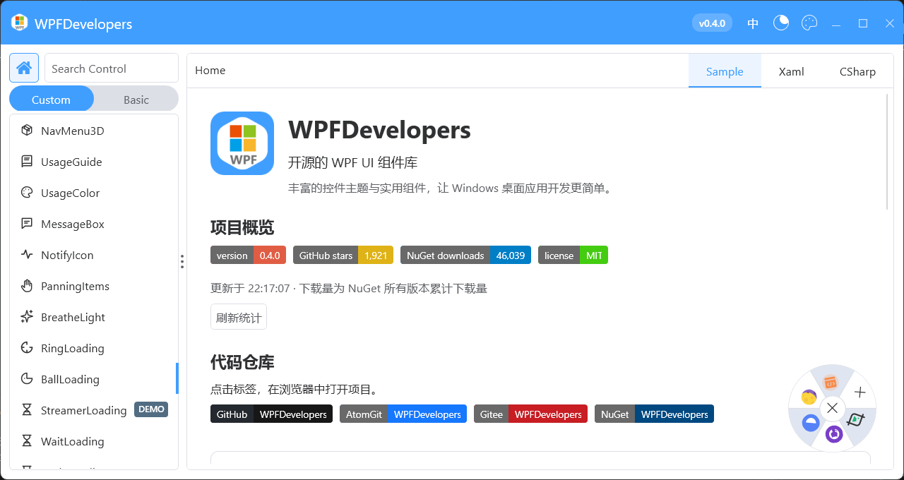

  <section class="wd-home-hero" aria-labelledby="wd-home-title">
    

      
WPF UI COMPONENT LIBRARY

      <h1 id="wd-home-title">让 WPF 界面 更现代，也更好用。</h1>
      
WPFDevelopers 为桌面应用提供常用控件、统一主题和丰富示例，帮助你更专注于产品本身。

      

        NuGet 安装
        <code>Install-Package WPFDevelopers</code>
      

      

        
支持 .NET Framework 4.0–4.8.1、.NET Core 3.0/3.1 和 .NET 5–10

        
支持浅色 / 深色主题与自定义主题色

      

    

    <figure class="wd-home-preview">
      
      <figcaption>在示例程序中浏览控件效果、主题与 XAML</figcaption>
    </figure>
  </section>

  <section class="wd-home-section" aria-labelledby="wd-home-features">
    

      
DESIGNED FOR WPF

      <h2 id="wd-home-features">从基础控件到完整界面，开发体验更连贯</h2>
    

    

      <article class="wd-home-feature">
        01
        <h3>一致的视觉语言</h3>
        
通过 Light / Dark 主题与可配置主题色，让应用中的控件保持协调。

      </article>
      <article class="wd-home-feature">
        02
        <h3>覆盖常见开发场景</h3>
        
输入、导航、布局、消息和图表等控件，减少重复搭建界面。

      </article>
      <article class="wd-home-feature">
        03
        <h3>示例与用法并行</h3>
        
查看可运行示例和 XAML 源码，从效果快速找到对应实现。

      </article>
    

  </section>

  <section class="wd-home-resources" aria-label="项目资源">
    项目资源
    <a href="https://github.com/WPFDevelopersOrg/WPFDevelopers">GitHub</a>
    <a href="https://atomgit.com/WPFDevelopersOrg/WPFDevelopers">AtomGit</a>
    <a href="https://gitee.com/WPFDevelopersOrg/WPFDevelopers">Gitee</a>
    <a href="https://www.nuget.org/packages/WPFDevelopers">NuGet</a>
  </section>

  <section class="wd-home-dock" aria-labelledby="wd-home-dock-title">
    

      <h2 id="wd-home-dock-title">下载与交流</h2>
      <section class="wd-home-dock__group" aria-labelledby="wd-home-dock-releases">
        <h3 id="wd-home-dock-releases">发行版下载</h3>
        

          <a href="https://github.com/WPFDevelopersOrg/WPFDevelopers/releases">GitHub</a>
          <a href="https://atomgit.com/WPFDevelopersOrg/WPFDevelopers/releases">AtomGit</a>
          <a href="https://gitee.com/WPFDevelopersOrg/WPFDevelopers/releases">Gitee</a>
        

      </section>
      <section class="wd-home-dock__group" aria-labelledby="wd-home-dock-community">
        <h3 id="wd-home-dock-community">社区交流</h3>
        

          <figure class="wd-home-dock__wechat">
            
            <figcaption>微信扫码关注</figcaption>
          </figure>
          

            
微信公众号：获取项目动态与开发分享。

            

              <a href="https://qm.qq.com/cgi-bin/qm/qr?k=m-8OmPjB6IbyHbRaZ7bvWE3YMqCRdLRG&amp;jump_from=webapi&amp;authKey=u1whDbb9cYqOU5LP5ACzTzY8Jrjd6vg1+AUziPpJpYP8LCSaQwdnINtqig2XLo3K" target="_blank" rel="noopener noreferrer">QQ 群 340500857</a>
              <a href="https://qm.qq.com/cgi-bin/qm/qr?k=CydklcUbeQgaX6D1tMtdxbV_U4ePOj6h&amp;jump_from=webapi&amp;authKey=6lqlfBFJETCyB4mhjLwmKs0mSgiyCGJ8kZ+/HbzmwsiZHoKNuqSnhEZC9Zhnwuzu" target="_blank" rel="noopener noreferrer">QQ 群 458041663</a>
              <a href="https://qm.qq.com/cgi-bin/qm/qr?k=3JrotSRmGvH1frVtmlcYC6QoGDF4Xamc&amp;jump_from=webapi&amp;authKey=OMtR125+dpG8Iuwxd7qxjCUXFu5DJQiRp1eW2dhHof8k7byDi5h2eLP5zQvUdhr3" target="_blank" rel="noopener noreferrer">QQ 群 929469013</a>
            

          

        

      </section>
    

  </section>

